# Sistema All-in-One Hoop
## Diagramas: modelo de dados, navegação e estados

Versão 3.3 | Complemento do documento de Estrutura de Telas v3.7

---

# PARTE 1: VISÃO MACRO

A espinha do sistema. Tudo que existe se pendura nessa linha.

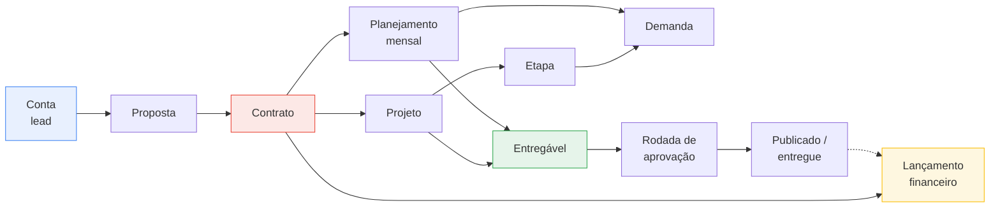

O contrato é o eixo. Ele é gerado pelo comercial, alimenta a produção e alimenta o financeiro. Se ele não existir como objeto, os três lados ficam desconectados e você digita tudo na mão.

---

# PARTE 2: MODELO DE DADOS

Separado em quatro domínios para leitura. As entidades de ligação entre domínios aparecem repetidas.

## 2.1 Domínio Comercial

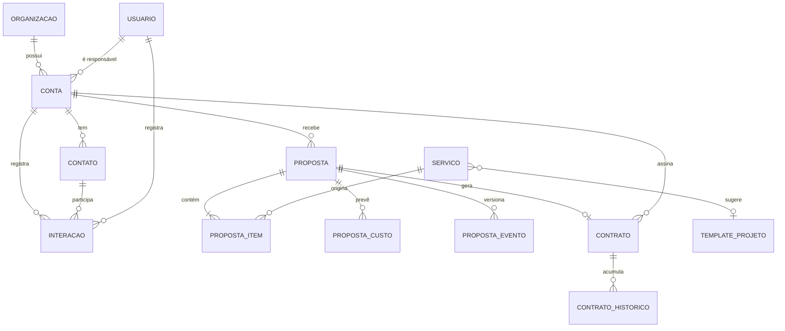

Pontos de atenção:

- **CONTA** é lead e cliente na mesma tabela. O campo `tipo` separa os dois mundos na interface, não no banco.
- **PROPOSTA para CONTRATO** é um para zero ou um. Proposta recusada simplesmente não gera contrato.
- **PROPOSTA_EVENTO guarda a negociação.** Cada mudança de valor, parcela, escopo ou situação vira registro, e "gerar nova versão" incrementa o número sem apagar o anterior. A proposta vigente é sempre a última versão; o histórico prova o que foi combinado antes.
- **CONTA sem PROPOSTA é válido.** Lead existe sem orçamento: nem toda conversa vira proposta.
- **CONTRATO_HISTORICO** guarda a trajetória de valores. O contrato guarda o valor vigente.

## 2.2 Domínio Produção

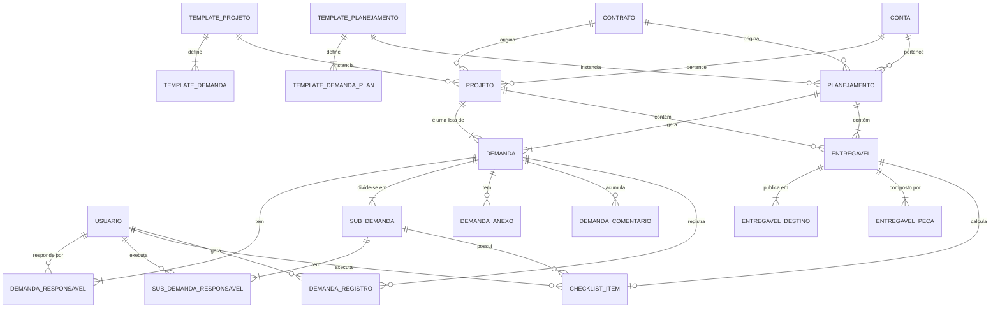

Pontos de atenção:

- **DEMANDA é a única unidade de trabalho.** Não há mais camada de etapa nem de frente. O projeto é uma lista ordenada de demandas com status; o planejamento gera uma demanda por natureza de trabalho (Redação, Arte, Tráfego), cada uma com seus responsáveis e prazo.
- **Responsáveis em dois lugares, de propósito:** a demanda tem responsáveis, e cada item de checklist pode ter o seu. É o que permite uma demanda de pesquisa ter concorrentes com uma pessoa e referências visuais com outra, sem virar três demandas.
- **SUB_DEMANDA é o checklist com dono.** Uma demanda tem uma ou mais. Com uma só, a interface esconde o conceito. Cada uma carrega nome, responsáveis, prazo e `criterio_conclusao`.
- **O critério define a natureza do checklist.** Manual é editável pela equipe (briefing, que é reunião; publicação, que é controle de quem colocou no ar). Automático espelha a aprovação da publicação e é travado (conteúdo e design). Espelho é medidor, não interruptor.
- **CHECKLIST_ITEM pendura na sub-demanda**, não na demanda.
- **"Frente do mês" do editor de planejamento é SUB_DEMANDA.** Mesmo objeto, apelido diferente herdado do protótipo. Não criar tabela nova.
- **Espelhamento tem sentido único:** ENTREGAVEL_PARTE alimenta CHECKLIST_ITEM. O item nunca escreve de volta na parte.
- **ENTREGAVEL tem dois sinalizadores de veiculação** (organico, impulsionado) e não um campo de escolha única. `verba` existe só quando impulsionado.
- **DEMANDA_REGISTRO guarda a origem da ação** (modal, lista, kanban, lote, automação), porque "quem mudou" sem "por onde" não resolve discussão.
- **COMENTÁRIO e REGISTRO são entidades separadas.** Conversa entre pessoas de um lado, prova do que aconteceu do outro. Misturar faz a pergunta importante sumir embaixo de oito marcações de checklist. Os dois aparecem do mais novo para o mais velho, e o registro nasce recolhido.
- **PLANEJAMENTO para DEMANDA é um para um.** Criar o planejamento cria uma demanda, e dentro dela as sub-demandas do template: Briefing, Conteúdo, Design, Publicação, e Tráfego quando houver.
- **ENTREGAVEL calcula CHECKLIST_ITEM.** Quando a demanda tem critério vinculado a publicação, o item fecha sozinho. Com critério manual, funciona como checklist comum.
- **ENTREGAVEL_DESTINO** é a plataforma, e só guarda registro de aprovação. Formato, texto e peças são da publicação, únicos. O formato é escolhido em família (vídeo vertical, carrossel, imagem) e cada plataforma exibe o nome nativo: Reels no Instagram, Shorts no YouTube, um arquivo só.
- **DEMANDA** continua com duas origens possíveis (etapa de projeto ou planejamento). As duas chaves existem, uma fica nula.

---

## 2.2.1 A anatomia de um planejamento

Uma demanda por mês, com as etapas dentro. Os nomes abaixo são exemplo, não padrão do sistema.

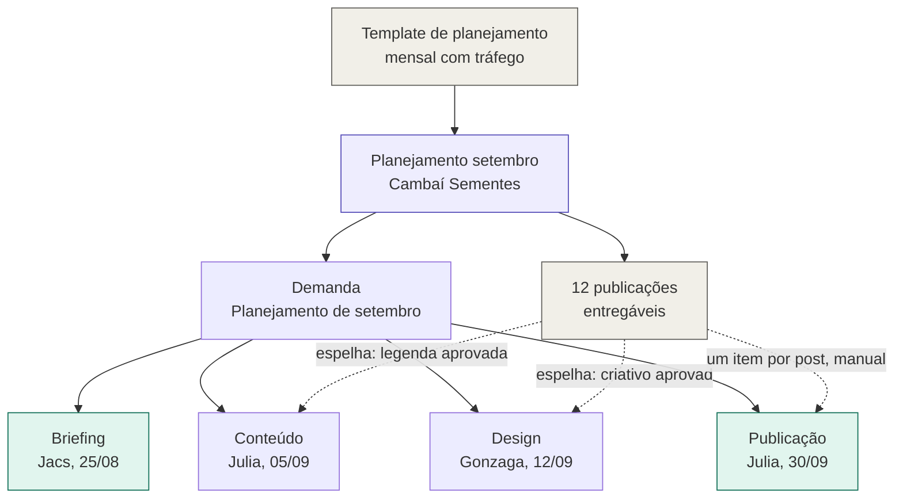

As três naturezas convivem na mesma demanda. **Briefing** é checklist interno de reunião, sem relação com publicação, e acontece antes de qualquer post existir. **Conteúdo e Design** são espelho: um item por publicação, travado, fechando quando o cliente aprova. **Publicação** tem um item por post mas é marcado pela equipe, porque é controle de quem colocou no ar.

No "Meu trabalho", o cartão é um só e se personaliza: o Gonzaga vê o selo Design com o prazo 12/09 e o progresso dele; a Julia vê Conteúdo com 05/09.

O conjunto de publicações não é fixo. Publicação extra pode entrar depois do envio ao cliente, data pode ser remanejada sem reabrir aprovação, e publicação não publicada pode migrar para o mês seguinte. Quando entra item novo, o denominador das etapas por publicação aumenta e a etapa concluída reabre.

---

# PARTE 3: MAPA DE NAVEGAÇÃO

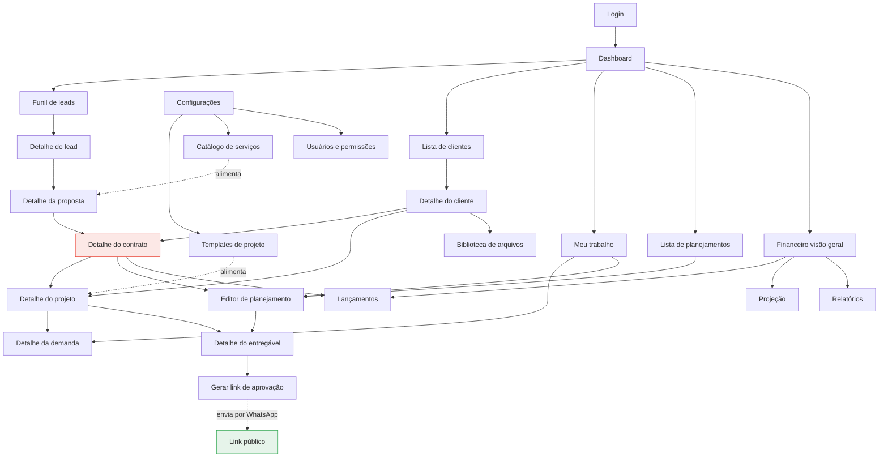

---

# PARTE 4: FLUXO DE APROVAÇÃO

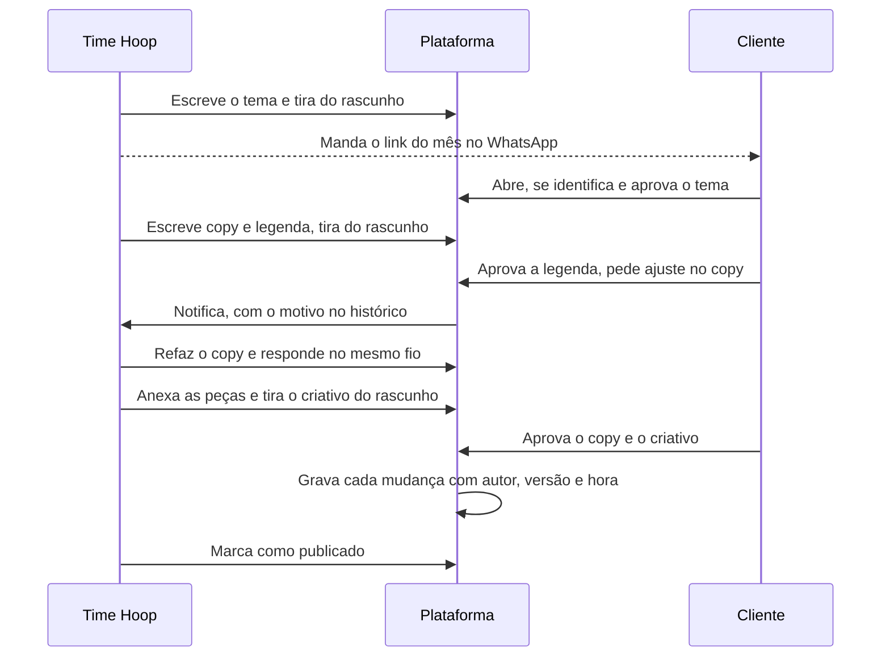

Um link só, do primeiro ao último dia do mês. O cliente vê as partes que saíram do rascunho e decide cada uma quando quiser, na ordem que quiser. Quando o ok chega por WhatsApp, a Hoop muda o status pelo modal e o registro guarda que foi ela quem marcou.

# PARTE 5: MÁQUINAS DE ESTADO

## 2.3 Domínio Financeiro

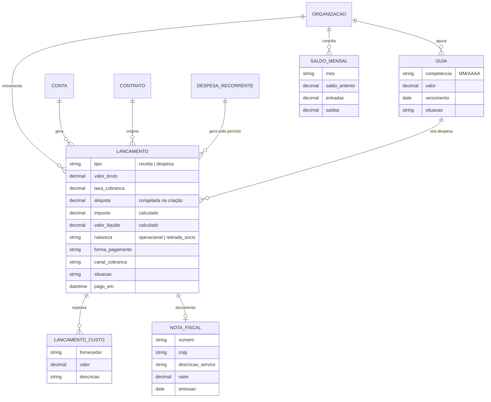

**Cinco regras que o diagrama carrega:**

- **`valor_bruto` não é receita.** Taxa, imposto e repasse saem dele. O resultado da operação usa `valor_liquido`.
- **A alíquota vem da GUIA**, por divisão (`valor da guia ÷ receita bruta do mês`), e **congela** em cada lançamento. O sistema não interpreta anexo, fator R nem faixa.
- **LANCAMENTO_CUSTO é o que liga despesa a receita.** Sem ele não existe margem real por cliente.
- **`natureza` separa retirada de sócio do custo operacional.** Misturadas, escondem se a operação se paga.
- **SALDO_MENSAL é caixa, em paralelo à competência.** São perguntas diferentes: quanto foi faturado e quanto está na conta.

## 5.1 Parte da publicação

As quatro partes (tema, copy, legenda, criativo) usam a mesma máquina, de forma independente.

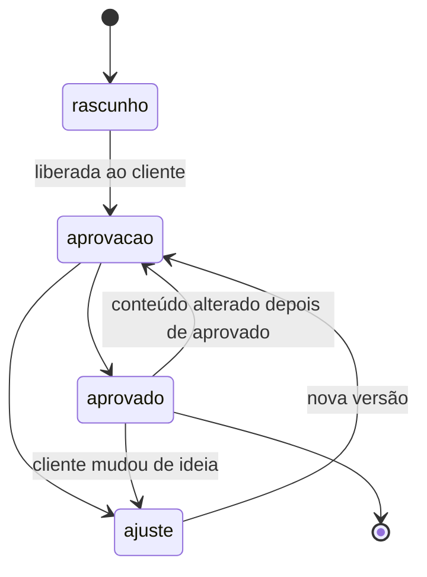

Qualquer transição pode ser feita pelo cliente, no link, ou pela Hoop, no modal. O registro guarda quem marcou. Não existe ordem obrigatória entre as partes: a legenda pode estar aprovada com o criativo ainda em rascunho.

## 5.2 Publicação (calculado a partir das partes)

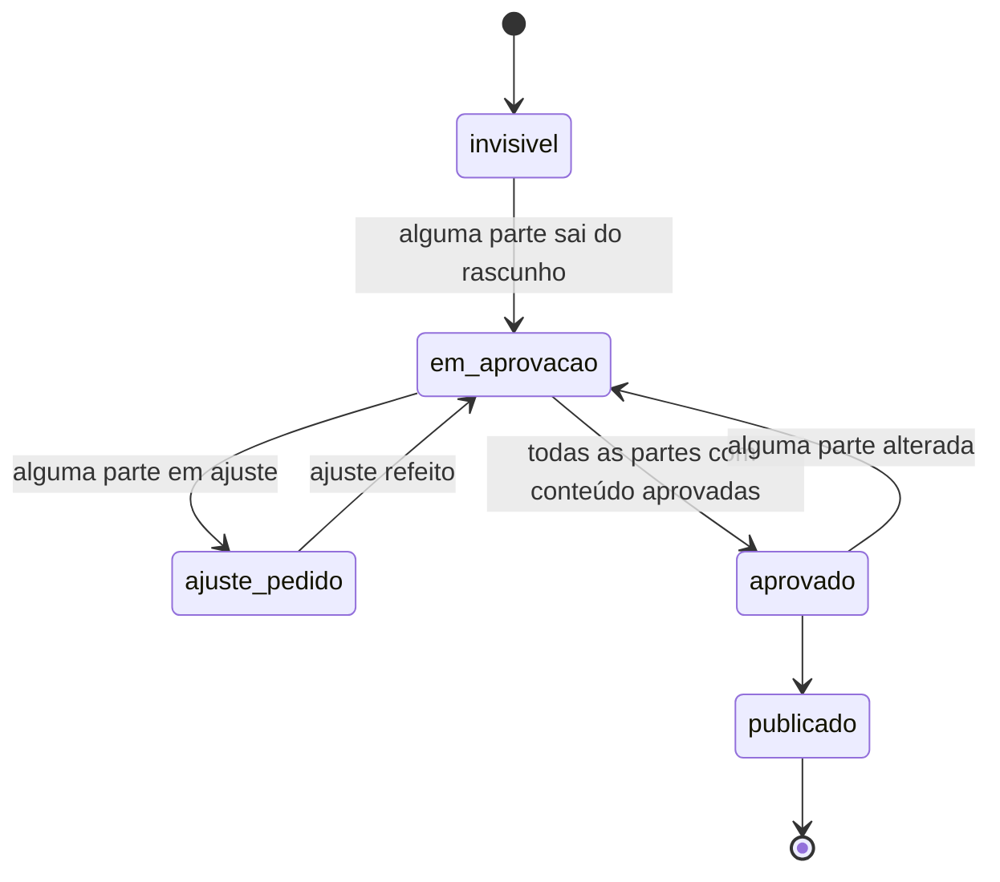

O estado da publicação nunca é digitado, é derivado. E `invisivel` não é um campo: é a consequência de todas as partes estarem em rascunho.

## 5.3 Conta (lead para cliente)

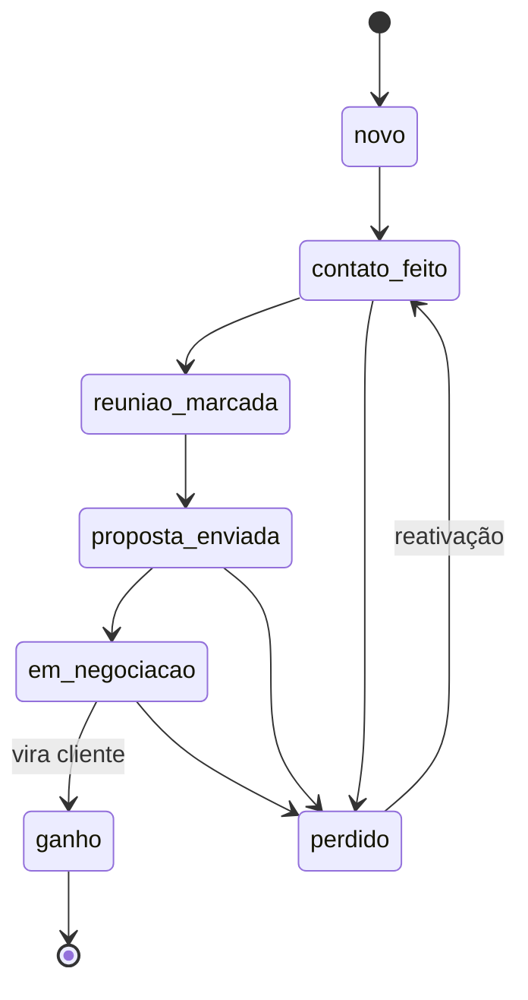

A conta não muda de tabela ao virar cliente. Só muda `tipo` e ganha `cliente_desde`.

## 5.4 Contrato

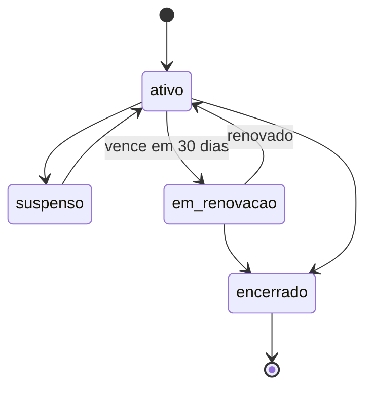

Reajuste e aditivo não mudam o estado. Geram registro em CONTRATO_HISTORICO e recalculam lançamentos futuros não faturados.

## 5.5 Projeto

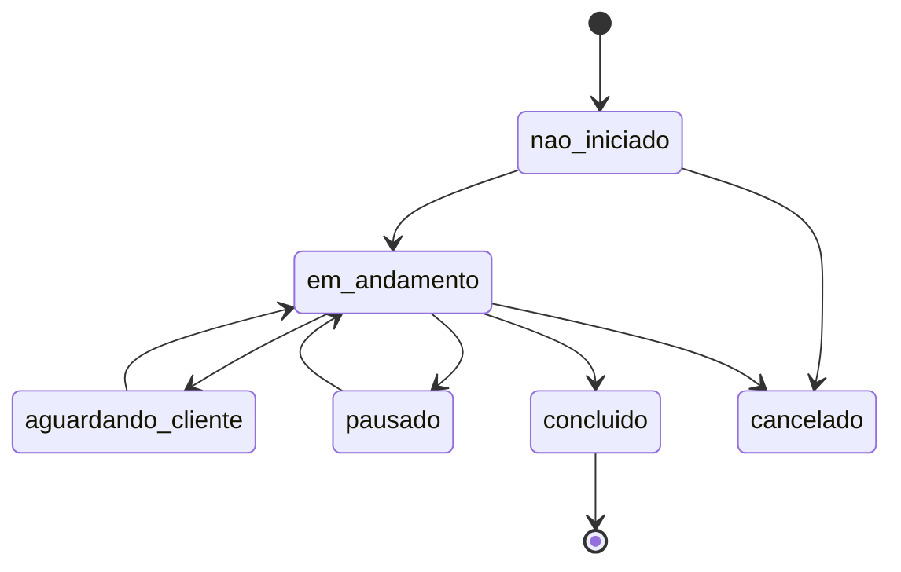

## 5.6 Arquivo

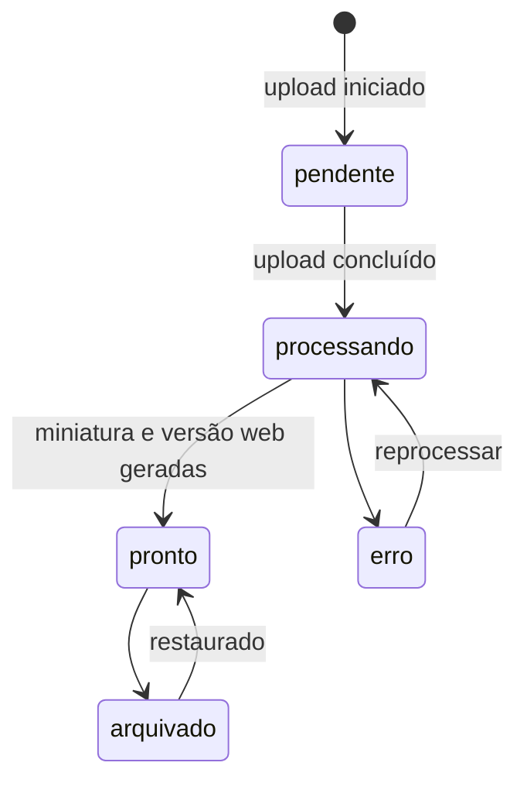

Nada é excluído. O estado final é arquivado, sempre reversível.

---

## 5.7 Demanda e sub-demanda

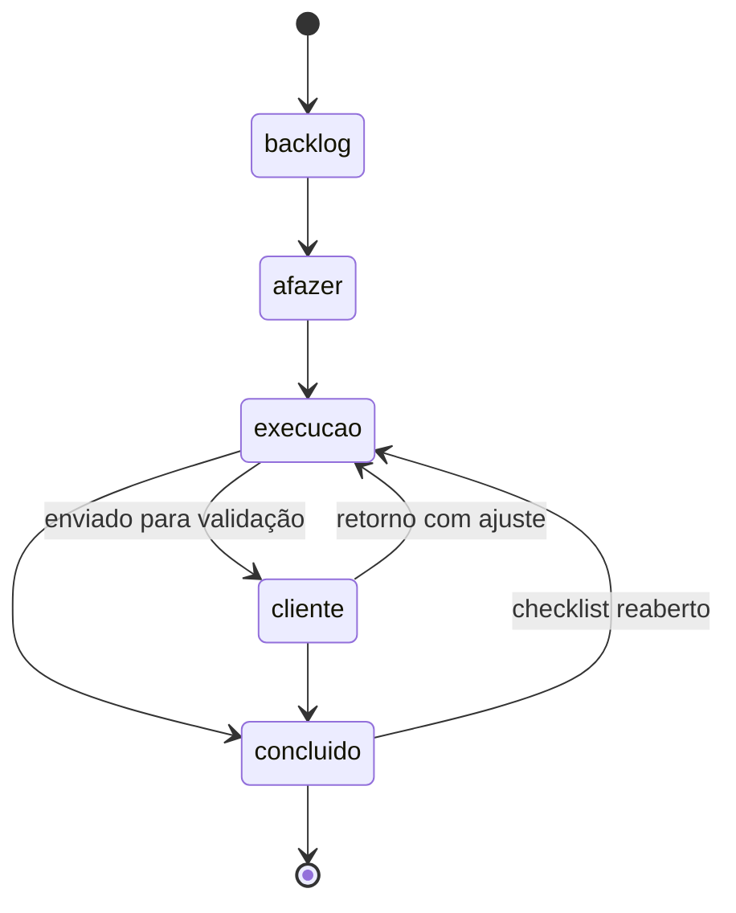

O status é o eixo do kanban do projeto. A demanda só vai para concluído quando **todos** os seus checklists fecham; desmarcar um item traz de volta para execução; arrastar para concluído marca tudo.

---

# PARTE 6: LEITURA DO CONJUNTO

Quatro coisas que os diagramas deixam visíveis e que o texto escondia:

1. **O contrato concentra três domínios.** Ele é filho da proposta, pai do projeto e do planejamento, e origem do lançamento financeiro. É a entidade de maior risco: errar o modelo dele quebra os três lados.

2. **Demanda e sub-demanda.** O desenho passou por duas camadas que morreram (frente e etapa de projeto) antes de chegar na sub-demanda, que é a frente reescrita com um propósito claro: dividir uma demanda em checklists com dono e prazo próprios. A diferença em relação à frente é que agora ela é explícita na tela e só aparece quando existe mais de uma. Projeto e planejamento usam a mesma estrutura: muda o critério de conclusão, não a entidade.

3. **Nenhuma nomenclatura é fixa, mas o comportamento precisa ser.** Nome de demanda é texto livre. O que faz o sistema saber quando um item fecha é o critério de conclusão, que é selecionável. Separar as duas coisas é o que permite flexibilidade total sem quebrar o cálculo.

4. **A aprovação é um subsistema, não um campo de status.** São quatro entidades trabalhando juntas (entregável, link, acesso, rodada) para responder uma pergunta simples: quem aprovou o quê, quando e em qual versão.

## 5.8 Guia e alíquota

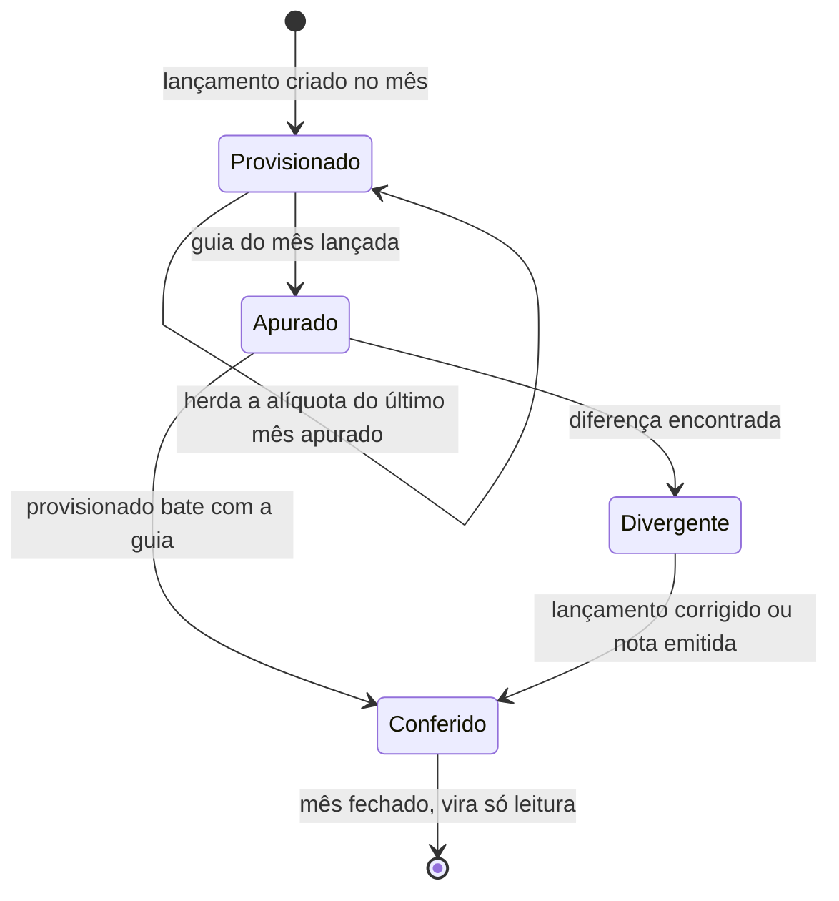

**A divergência é o valor da tela.** Ela aponta receita sem nota, lançamento faltando ou mudança de faixa, que é justamente o que passa despercebido na planilha.
